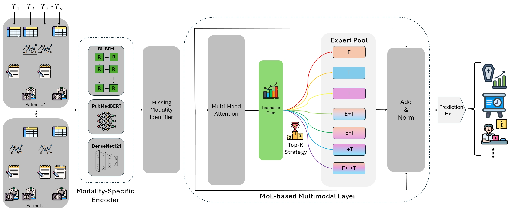

<div align="center">

# MoE-Health: A Mixture of Experts Framework for Robust Multimodal Healthcare Prediction

**Xiaoyang Wang<sup>1</sup> &nbsp;·&nbsp; Christopher C. Yang<sup>1</sup>**

<sup>1</sup>Drexel University

[](https://acm-bcb.org/) [](https://doi.org/10.1145/3765612.3767207) [](pyproject.toml) [](LICENSE)

</div>

<p align="center">
  
</p>

**Figure 1** | MoE-Health (Figure 2 of the paper). Each modality has its own encoder, and an absent modality is replaced by its learned missing embedding. Multi-head attention fuses the modality tokens. A learnable gate then sends each patient to the top-k of seven experts, one per modality combination, and the expert output passes through Add & Norm to the prediction head.

Clinical prediction models usually assume that every patient comes with every modality. In practice a patient has some subset of EHR time series, clinical notes and chest X-rays. **MoE-Health** handles any such combination in one model:
- every modality has its own encoder;
- a missing modality is represented by a learned embedding;
- a gating network routes each patient to experts specialised for modality combinations;
- a load-balancing loss keeps all experts in use.

On MIMIC-IV it predicts in-hospital mortality, long length of stay (> 7 days) and 30-day readmission from the first 48 hours of an admission.

This repository contains the full pipeline from the PhysioNet source files to trained models: cohort construction, feature extraction for the three modalities, MoE-Health with its training stages, the experiment grids and the unit tests. It ships no patient-derived data; the cohort and every feature are rebuilt from the credentialed datasets on your own machine.

## Run the pipeline

```bash
git clone https://github.com/wangxiaoyang0412/MoE-Health.git
cd MoE-Health
bash run/pipeline/setup_env.sh        # Python 3.11 venv, torch 2.7.1 + CUDA 12.6, this package (editable)
.venv/bin/python -m pytest -q         # 47 tests on synthetic data, no MIMIC access needed
```

Point the four source paths in `run/conf/paths/default.yaml` at your PhysioNet downloads. Alternatively, copy that file to `run/conf/paths/local.yaml`, which git ignores, and add `paths=local` to every command (`--paths local` for `launch.py` and `collect_results.py`). The scripts read uncompressed tables, so gunzip the `.csv.gz` files first. Run every command from the project root with `.venv/bin/python`:

| Step | Command | Writes |
|---|---|---|
| Cohort and splits; checks the counts of paper Fig. 3 | `run/pipeline/build_cohort.py` | `outputs/cohort/` |
| EHR, paper variable list | `run/pipeline/extract_ehr.py` | `outputs/features/ehr_*` |
| EHR, extended ICU variable set (tuned recipe) | `run/pipeline/extract_ehr.py ehr.version=v2` | `outputs/features/ehr_values_v2.npy` |
| Notes: Bio_ClinicalBERT embeddings | `run/pipeline/extract_notes.py notes.device=cuda:0` | `outputs/features/note_emb*.npy` |
| Notes: TF-IDF features (tuned recipe) | `run/pipeline/extract_notes_tfidf.py` | `outputs/features/note_emb_tfidf_s*.npy`, `note_tfidf_logit_*.npy` |
| Chest X-rays: DenseNet-121 features | `run/pipeline/extract_cxr.py cxr.device=cuda:0` | `outputs/features/cxr_emb*.npy` |
| Prior-utilisation codes (tuned recipe) | `run/pipeline/extract_history.py` | `outputs/features/history_*` |
| One run, paper settings | `run/train.py model=moe_health task=mortality seed=0` | `outputs/runs/main/moe_health/corrected/mortality/seed0/` |
| One run, tuned recipe | `run/train.py model=moe_health +recipe=moe_final task=mortality seed=0` | same layout |
| All experiment grids | `run/pipeline/launch.py main table2 ablation --gpus 0 1 --jobs-per-gpu 3` | `outputs/runs/{main,table2,ablation}/` |
| Summary tables | `run/pipeline/collect_results.py` | `outputs/results/{runs.csv,summary.md}` |

A tuned-recipe run takes about 2.5 minutes on one A40 GPU.

`launch.py` skips runs that already have a `metrics.json`. Before starting a job it waits until the GPU has at least 8 GB of free memory, and it limits each job to 4 CPU threads.

The three grids:

| Grid | Runs | Content |
|---|---|---|
| `main` | 105 | MoE-Health with the tuned recipe and with the paper settings: 2 cohorts × 3 tasks × 5 seeds. Also unimodal EHR / notes / CXR models on the corrected cohort |
| `table2` | 30 | LOS with the modality subsets E, T, I, E+T, E+I, T+I |
| `ablation` | 45 | mortality: the paper's Table 3 ablations and further variants |

Each run writes `metrics.json`, `predictions.npz` and `config.yaml`:
- `metrics.json` has AUROC, AUPRC, F1 at the validation-optimal threshold, per-combination metrics and routing statistics.
- `predictions.npz` holds per-sample predictions. These are credentialed data; keep them with the MIMIC files.

## Method in brief

**Encoders** (`src/model_module/encoders.py`).
- **EHR:** a BiLSTM over 48 hourly bins of vital signs, labs, procedures and medications, concatenated with embeddings of the static demographics (Eq. 6).
- **Notes:** the FINDINGS / IMPRESSION sections of the radiology reports written in the first 48 hours, encoded by a frozen Bio_ClinicalBERT (Eq. 7, `run/pipeline/extract_notes.py`).
- **Chest X-rays:** the earliest antero-posterior image in the window, encoded by a CheXpert-pretrained DenseNet-121 from torchxrayvision, with global average pooling (Eq. 8, `run/pipeline/extract_cxr.py`).

**Missing modalities and fusion** (`src/model_module/moe_health.py`). A learned embedding per modality replaces the output of an absent encoder (Eq. 9). The three modality tokens then pass through 4-head attention.

**MoE layer** (`src/model_module/moe.py`).
- A gating MLP scores seven experts, one per modality combination: E, T, I, E+T, E+I, T+I, E+T+I (Eq. 11).
- The top-k experts are combined with renormalised weights (Eq. 12).
- The expert output is added to the token representation, normalised and passed to the prediction head (Fig. 2). `model.expert_output=logit` uses the literal form of Eq. 12 instead.
- The load-balancing loss is α · CV(f ⊙ p) (Eqs. 15–16).

**Training** (`src/trainer_module/moe_procedure.py`), in stages:
1. Optional: each encoder is pretrained on its own modality.
2. The encoders are trained with a single generic expert.
3. Each expert is pretrained on the patients whose modalities include its combination; `model.pretrain=exact` restricts this to exactly that combination.
4. Optional: gate warm-up.
5. Joint training with BCE plus the balance loss, with early stopping on validation AUROC.

**Configurations.**
- **Paper settings:** `model=moe_health` with AdamW, lr 1e-4, batch 32, at most 50 epochs, α = 0.01, top-2 and 4 attention heads.
- **Tuned recipe:** `+recipe=moe_final`, with training settings and inputs chosen on validation AUROC. It adds per-modality encoder pretraining (step 1 above), an extended ICU variable set, 48 h summary statistics, prior-utilisation codes and TF-IDF report features. The architecture and the loss are the paper's.

| Options | |
|---|---|
| `model.*` (`run/conf/model/moe_health.yaml`) | `experts` (all7, observed4), `pretrain` (superset, exact, generic, none), `top_k`, `gating` (learned, uniform), `missing` (learned, zeros), `expert_output` (repr, logit), `balance` (cv, switch, none), `alpha` |
| `data.*` (`run/conf/train.yaml`) | `modalities` (any subset of ETI), `ehr_version` (v1, v2), `ehr_stats`, `ehr_delta`, `note_variant` (cls, tok, tfidf, tok_tfidf), `note_logit`, `cxr_variant` (first, mean), `history` |
| `train.*` (`run/conf/train.yaml`) | optimiser, early stopping, modality dropout, per-group learning-rate multipliers |

## Data

All datasets are on PhysioNet and require credentialed access:

| Dataset | Version | Used for |
|---|---|---|
| [MIMIC-IV](https://physionet.org/content/mimiciv/1.0/) | 1.0 | admissions, patients, ICU stays, chart / lab / procedure / input events |
| [MIMIC-CXR-JPG](https://physionet.org/content/mimic-cxr-jpg/2.0.0/) | 2.0.0 | chest X-ray images and metadata |
| [MIMIC-IV-Note](https://physionet.org/content/mimic-iv-note/2.2/) | 2.2 | radiology reports |
| [HAIM-MIMIC-MM](https://physionet.org/content/haim-multimodal/1.0.1/) | 1.0.1 | `haim_mimiciv_key_ids.csv`, the cohort key ids |

The cohort has 31,088 admissions with 5 patient-level 80/10/10 splits. Select the label set with `cohort=`:
- **`faithful`** follows the paper's labels:
  - death is `discharge_location == DIED`;
  - long LOS is LOS > 7 days;
  - readmission is searched among the cohort's own admissions.
- **`corrected`** (the default, 28,403 admissions):
  - drops the admissions that end within the 48 h input window, so every outcome occurs after prediction time;
  - takes mortality from `hospital_expire_flag`;
  - counts readmission against the full MIMIC-IV admissions table, with in-hospital deaths excluded.

## Repository layout

```
src/
  data_module/     cohort rules, EHR variable spec and DuckDB extraction, note sections,
                   TF-IDF note features, prior-utilisation codes, dataset loader
  model_module/    encoders, MoE layer (gate, top-k routing, balance loss), MoE-Health, unimodal model
  trainer_module/  training loop, MoE-Health training stages, unimodal training
  metrics_module/  AUROC, AUPRC, F1 at the validation-optimal threshold
run/
  conf/            Hydra configs: train.yaml, pipeline.yaml, model/, recipe/, paths/
  pipeline/        cohort and feature extraction, grid launcher, result collector, environment setup
  train.py         one (method, cohort, task, seed) run
tests/             unit and smoke tests on synthetic data
assets/            figure used in this README
LICENSE            MIT
```

## Citation

```bibtex
@inproceedings{wang2025moehealth,
  title     = {{MoE-Health}: A Mixture of Experts Framework for Robust Multimodal Healthcare Prediction},
  author    = {Wang, Xiaoyang and Yang, Christopher C.},
  booktitle = {Proceedings of the 16th ACM International Conference on Bioinformatics, Computational Biology,
               and Health Informatics (BCB '25)},
  year      = {2025},
  address   = {Philadelphia, PA, USA},
  publisher = {Association for Computing Machinery},
  doi       = {10.1145/3765612.3767207}
}
```

## License and acknowledgments

The code in this repository is released under the MIT License. The MIMIC datasets are not covered by it; their use is governed by the PhysioNet credentialed data use agreements. The cohort is built from the key-id table of HAIM-MIMIC-MM (Soenksen et al., 2022). This work was supported in part by the National Science Foundation under the Grants IIS-1741306 and IIS-2235548, and by the Department of Defense under the Grant DoD W91XWH-05-1-023.

Questions: xw388@drexel.edu, or open a GitHub issue.
